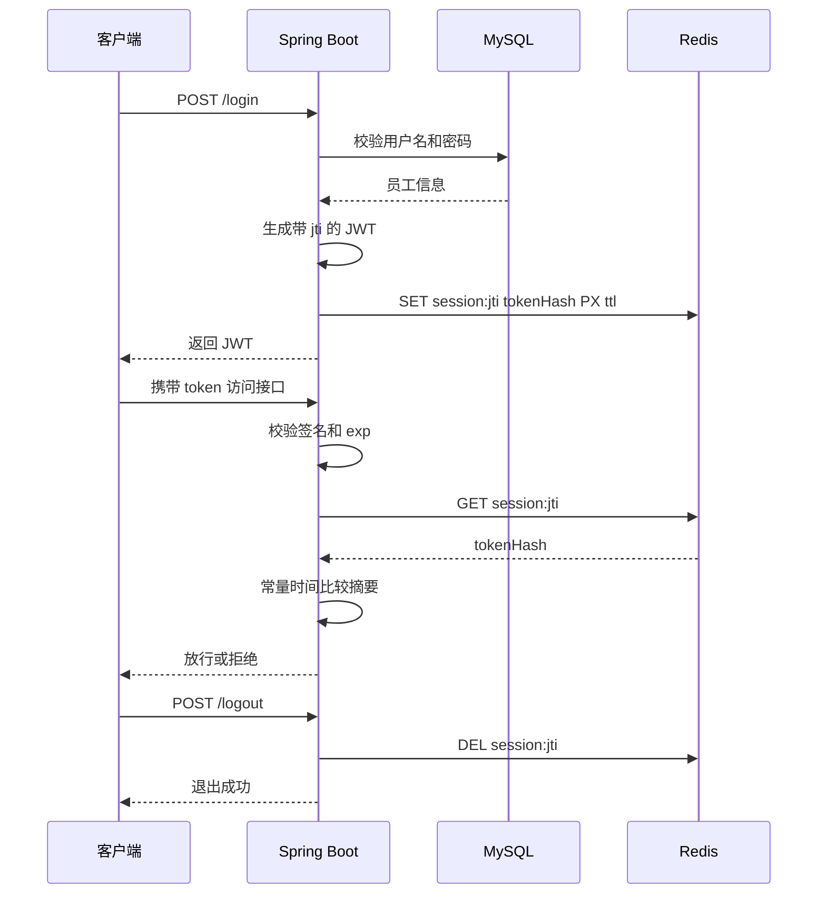

# JWT 持久化学习指南

这份文档用于学习本项目中的 JWT 持久化实现。建议一边阅读源码，一边启动 Redis 完成实验。

## 1. 学习目标

完成本章后，你应该能够解释并实现以下内容：

- JWT 为什么默认无法主动失效；
- `jti`、Redis Key、令牌摘要和 TTL 分别解决什么问题；
- 登录、鉴权、退出登录三个流程如何连接起来；
- 为什么业务缓存可以降级，而登录会话校验应当 fail-closed；
- 如何通过测试和 Redis 命令验证会话是否真正失效。

## 2. 先理解“持久化”的含义

JWT 本身仍由客户端保存，服务端持久化的是 JWT 对应的**活跃会话状态**。

原来的无状态模式只验证签名和过期时间。JWT 一旦签发，在到期前即使用户点击退出，服务端也无法主动撤销它。当前方案在 Redis 中维护会话白名单：JWT 合法并且对应 Redis 会话仍存在时，请求才会被接受。

| 职责 | JWT | Redis 会话 |
|---|---|---|
| 证明令牌由服务端签发 | 是 | 否 |
| 携带员工 ID、用户名 | 是 | 否 |
| 判断令牌是否过期 | 是 | TTL 辅助清理 |
| 支持主动退出、撤销 | 否 | 是 |
| 每次请求是否查询 | 本地解析 | 查询一次 Redis |

## 3. 整体流程



## 4. Redis 中保存了什么

会话数据结构如下：

```text
Key   = tlias:auth:session:<jti>
Value = SHA-256(完整JWT)
TTL   = JWT过期时间 - 当前时间
```

示例：

```text
tlias:auth:session:6bc4d42f-...
  -> 39b6315a...（64位十六进制摘要）
  -> TTL 43120秒
```

保存摘要而不是原始 JWT，是为了避免 Redis 数据泄露后令牌被直接重放。这里的 SHA-256 用于令牌摘要，不适合保存用户密码；密码应使用 BCrypt、Argon2 等专用算法。

## 5. 按顺序阅读源码

### 第一步：生成唯一会话标识

阅读 [`JwtUtils`](../src/main/java/com/itheima/utils/JwtUtils.java)。生成 JWT 时增加：

```java
.setId(UUID.randomUUID().toString())
.setIssuedAt(issuedAt)
.setExpiration(new Date(issuedAt.getTime() + properties.getExpireMs()))
```

`jti` 标识一次登录，而不是一个用户。同一用户登录两次会产生两个 `jti`，因此可以实现多端登录和单端退出。

### 第二步：登录后创建会话

阅读 [`EmpServiceImpl.login`](../src/main/java/com/itheima/service/impl/EmpServiceImpl.java)。顺序是：

1. MySQL 校验账号密码；
2. 生成 JWT；
3. 解析 JWT 中的 `jti` 和过期时间；
4. 调用 `JwtSessionService.createSession` 写入 Redis；
5. Redis 写入成功后才把 JWT 返回客户端。

### 第三步：理解会话服务

重点阅读 [`JwtSessionService`](../src/main/java/com/itheima/service/JwtSessionService.java)：

- `createSession`：写入摘要并设置剩余 TTL；
- `isActive`：查询摘要并使用 `MessageDigest.isEqual` 比较；
- `revoke`：根据 `jti` 删除当前会话；
- `sessionKey`：统一生成 Redis Key；
- `unavailable`：把 Redis 异常转换为明确的会话存储异常。

思考：为什么不能只判断 Redis Key 存在，而还要比较令牌摘要？因为这样可以确保该 `jti` 对应的是当前这一个完整令牌。

### 第四步：每次请求校验会话

阅读 [`TokenInterceptor`](../src/main/java/com/itheima/interceptor/TokenInterceptor.java)。受保护请求必须同时通过：

1. 请求头存在 `token`；
2. JWT 签名正确且未过期；
3. Redis 会话存在；
4. Redis 摘要与当前 JWT 匹配。

| 场景 | HTTP 状态码 | 原因 |
|---|---:|---|
| 未携带令牌 | 401 | 尚未认证 |
| JWT 被篡改或过期 | 401 | 无效凭证 |
| Redis 会话不存在 | 401 | 已退出或已撤销 |
| Redis 不可用 | 503 | 暂时无法安全确认会话状态 |

### 第五步：退出并立即失效

阅读 [`LogoutController`](../src/main/java/com/itheima/controller/LogoutController.java)。退出操作解析当前 JWT 的 `jti`，然后删除对应 Redis Key。客户端即使继续保存这个 JWT，也会在下次请求时因会话不存在而收到 401。

## 6. 为什么 Redis 故障时不能直接放行

业务缓存读取失败时可以回退 MySQL，因为数据仍有权威来源。会话校验失败时如果跳过 Redis，相当于让所有已经退出或被撤销的 JWT 重新生效。

因此项目采用 fail-closed 策略：无法确认登录态时返回 503，不把 Redis 故障误判为用户未登录，也不绕过撤销检查。

## 7. 动手实验

先启动 MySQL、Redis 和后端，并准备一个可登录账号。

### 实验一：登录并观察 Redis

```powershell
$body = @{ username = "你的用户名"; password = "你的密码" } | ConvertTo-Json
$login = Invoke-RestMethod -Method Post -Uri "http://localhost:8080/login" `
  -ContentType "application/json" -Body $body
$token = $login.data.token

redis-cli --scan --pattern "tlias:auth:session:*"
```

复制查询到的 Key，观察摘要和 TTL：

```powershell
redis-cli GET "tlias:auth:session:你的jti"
redis-cli TTL "tlias:auth:session:你的jti"
```

预期结果：Value 是 64 位摘要，TTL 会随时间递减。

### 实验二：验证退出即失效

```powershell
Invoke-RestMethod -Method Post -Uri "http://localhost:8080/logout" `
  -Headers @{ token = $token }
```

再次查询 Redis，Key 应当消失；再次携带原 JWT 访问受保护接口，应返回 401。

### 实验三：验证多端会话

连续登录两次并分别保存两个 JWT。Redis 中应出现两个不同 `jti`。退出第一个 JWT 后，第一个返回 401，第二个仍可正常访问。

### 实验四：验证 fail-closed

登录成功后停止 Redis，再携带合法 JWT 请求受保护接口，预期返回 503。重新启动 Redis 后，如果会话数据仍在且 JWT 未过期，请求可以继续通过。

## 8. 通过测试理解边界

阅读并运行：

```powershell
mvn clean test
```

重点测试文件：

- [`jwtTest`](../src/test/java/com/itheima/jwtTest.java)：验证生成的 JWT 包含 `jti`、签发时间和过期时间；
- [`JwtSessionServiceTests`](../src/test/java/com/itheima/JwtSessionServiceTests.java)：验证写入 TTL、摘要匹配和撤销；
- [`TokenInterceptorTests`](../src/test/java/com/itheima/TokenInterceptorTests.java)：验证放行、401 和 Redis 故障时的 503。

## 9. 常见误区

- **把 JWT 原文存入 Redis**：泄露后可直接作为凭证使用；当前实现只存摘要。
- **TTL 使用固定值**：代码执行会消耗时间，固定 TTL 可能晚于 JWT 到期；应使用剩余有效期。
- **退出只删除浏览器里的 JWT**：服务端无法阻止被复制的旧 JWT；必须撤销服务端会话。
- **Redis 故障时只校验签名**：会绕过退出和撤销机制。
- **所有登录共用用户 ID 作为 Key**：会导致后一次登录挤掉前一次；使用 `jti` 才能区分设备会话。

## 10. 自测题与进阶练习

先不看源码回答：

1. 为什么 JWT 签名正确不代表当前会话仍然有效？
2. `jti` 为什么不能直接使用员工 ID？
3. 为什么 Redis TTL 要取 JWT 的剩余有效期？
4. 401 和 503 在当前鉴权流程中分别代表什么？
5. 删除一个 `jti` 为什么不会影响同一账号的其他设备？

建议的进阶练习：

1. 增加“退出所有设备”，按员工 ID 维护会话索引并批量撤销；
2. 将请求头升级为标准的 `Authorization: Bearer <token>`；
3. 增加短期 Access Token 与长期 Refresh Token；
4. 记录设备信息、登录 IP、创建时间和最后访问时间；
5. 增加管理员强制下线接口和对应审计日志。

完成上述实验和自测后，再阅读 [`JWT 持久化会话设计`](jwt-session-design.md)，对照设计取舍总结一遍完整流程。
